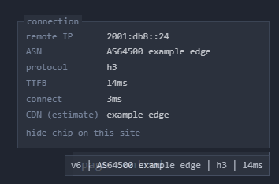

# labstart

Based on [re-start by refact0r](https://github.com/refact0r/re-start). labstart adds homelab and network status to its terminal-style new tab, plus a toolbar badge with a status popup, a small connection chip on web pages and quiet outage alerts.




## Install

Download the zip from [Releases](../../releases) and extract it, or build it yourself with Node 24:

```sh
npm ci
npm run build
```

Open `chrome://extensions` (in Helium `helium://extensions`), turn on **Developer mode**, click **Load unpacked** and pick the extracted folder or `dist/chrome`.

## Use

Open **labstart** in the top right of the new tab or **settings** in the toolbar popup to configure it. **Demo mode** fills everything with fake data, **simulate outage** shows the alert line and a notification.

- **New tab:** `homelab`, `net` and `claude` boxes with sparklines. Pick which boxes show, their order and which source feeds each row.
- **Toolbar:** the icon shows one value of your choice (for example the server temperature) and turns yellow or red when a check is bad. Click it for all boxes and a list of your other extensions: open their settings or switch them on and off.
- **Site chip:** click **enable website overlays** first. It shows address family, ASN, protocol and time to first byte. It stays faint, moves out of the way when the pointer comes near (move along the bottom edge of the window to reach it), hides while scrolling, in fullscreen and on video sites. Click it for details. **Alt+Shift+S** toggles it everywhere, and each site can be switched off.
- **Alerts:** when a check turns bad, a 2 px line appears along the top of web pages and one notification is sent per state change, at most once every 10 minutes per state.

## Sources

Under **sources**, click **add source**, then **test source** to see the raw response and the mapped values. **save** asks for access to the source's host.

- **Custom JSON:** URL, optional header (`Authorization: Bearer …`), fields with dot paths (`cpu.temperature`, `disks[0].used`), unit and warn/crit thresholds. Arrays can be counted, booleans become yes/no, and values like `"3 of 5"` or `"3/5"` are read as a fraction (thresholds then use the percentage). Two separate paths work too, with **part / total**.
- **Uptime Kuma** status page, **AdGuard Home** (basic auth), **own egress** IPv4/IPv6 via Cloudflare's trace endpoint, **Claude usage** (unofficial, off by default).

Example: for `{"cpu":{"temperature":57},"tunnels":"3 of 3"}` from `http://192.0.2.10:9000/stats`, add the fields `cpu.temperature` (unit `°C`, warn `70`, crit `85`) and `tunnels` (crit `99`, direction below).

Private `http://` addresses work once access to the host is granted. In Chromium 158 no extra Local Network Access prompt appeared for the extension.

## Privacy

Requests only go to the sources you configure. Credentials stay in local extension storage and are left out of exports. The chip uses the IP and timing the browser already has, without extra requests to the site. Optional, off by default: ASN lookup sends visited sites' IPs to RIPEstat, reverse DNS asks Cloudflare DNS for a site's PTR name when you open the details box. The new tab contacts Open-Meteo for weather and your task provider if you use one.

Permissions: `storage`, `alarms` (polling), `notifications`, `webRequest` (main-document IP, read only), `scripting` (overlays), `management` (extension list in the popup). Website access and source hosts are optional and asked for when needed.

## License

MIT, see [LICENSE](LICENSE).
