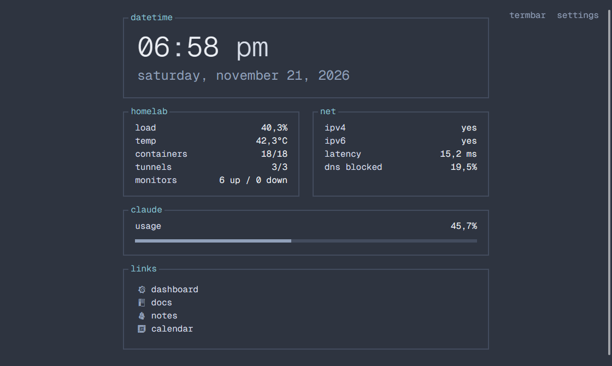
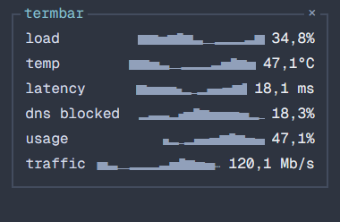

# termbar

Based on [re-start by refact0r](https://github.com/refact0r/re-start). termbar adds homelab and network status to its terminal-style new tab, plus a small site connection chip, a floating HUD and outage alerts.






## Install

Build with Node 24, or extract the Chrome zip from Releases. On `helium://extensions` or `chrome://extensions`, turn on **Developer mode**, choose **Load unpacked**, and select `dist/chrome` or the extracted release folder.

```sh
npm ci
npm run build
```

The build writes `dist/chrome` and `dist/termbar-chrome-v0.1.0.zip`.

Open **termbar** from the new tab to configure it. Enable **demo mode** to try the panels, then use **simulate outage** to see the alert. **Enable website overlays** to show the chip and alert line on web pages. The chip supports per-site hiding and **Alt+Shift+S** toggles it globally.

Use **Alt+Shift+H** on a supported secure page or the termbar new tab to toggle the floating HUD. The toolbar action opens the HUD or brings up the launcher, where **open floating HUD** supplies the browser's required user gesture. A HUD uses its opening document for its lifetime. Use the launcher if you plan to navigate the site tab. [Chrome Document Picture-in-Picture](https://developer.chrome.com/docs/web-platform/document-picture-in-picture/)

The new tab includes re-start's themes, weather, links, stats, tasks and custom CSS. Local and Todoist tasks ship in the release. To use Google Tasks, build with `TERMBAR_GOOGLE_TASKS_CLIENT_ID` set to an OAuth client ID registered for your unpacked extension ID, then grant identity access when signing in.

## Connect a source

1. Under **sources**, choose **add source** and select its type. For custom JSON, use an endpoint such as `https://status.example.com/metrics`. Set the optional header name and value if it needs authentication.
2. Add a field with metric ID `temp`, JSON path `cpu.temperature`, unit `°C`, warning `70`, and critical `85`. For a response like `{"cpu":{"temperature":57}}`, **test source** should show `57` with that unit. To display containers as `7/8`, use **part / total** with `containers.up` and `containers.total`. Its thresholds use the percentage.
3. Choose the source and metric ID for the row in **new-tab boxes**, then **save** and grant access. Polling intervals start at 30 seconds. Sources include Uptime Kuma status pages, AdGuard Home, configurable Cloudflare-based IPv4/IPv6 egress checks, and optional unofficial Claude usage.

For a private HTTP endpoint, run **test source** from the options page and allow access to the source origin. If the browser also prompts for Local Network Access, allow it there so future worker polls can use it. [Chrome Local Network Access](https://developer.chrome.com/docs/modern-web-guidance/guides/security/local-network-access)

## Privacy

Source polling sends requests to the configured endpoints. Source credentials stay in local extension storage. JSON exports carry the settings and mappings. The chip reads the main document's IP and navigation timing from Chromium. Enabling ASN lookups sends public visited-site IPs to RIPEstat and caches returned prefixes for the browser session. Claude usage uses the existing claude.ai login when configured. The startpage contacts Open-Meteo for weather and contacts your configured task provider or ping target when used.

The manifest uses storage for config and session status, alarms for polling, notifications for debounced state changes, and non-blocking webRequest for main-document IPs. Scripting injects the opt-in website overlays, and activeTab lets the toolbar try opening the HUD in the current tab. Source hosts and all-web overlay access are optional grants. The Google Tasks build adds optional identity.

MIT. See [LICENSE](LICENSE).
